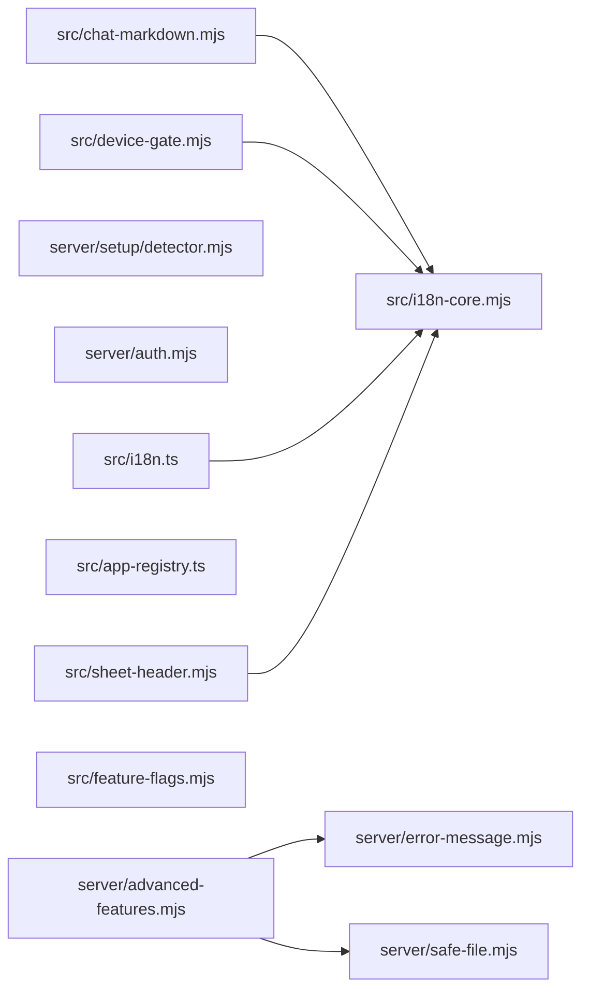

# Module dependency graph (#356)

Generated on 2026-11-20 from `main` with `npm run deps:graph -- --top 12`. Regenerate it after large refactors. Only relative imports in `src/`, `server/` and `server.mjs` are counted; locales are excluded.

177 modules, 342 relative imports

| Module | Imported by | Imports |
|---|---|---|
| `src/i18n.ts` | 33 | 1 |
| `server/error-message.mjs` | 17 | 0 |
| `server/safe-file.mjs` | 12 | 0 |
| `src/sheet-header.mjs` | 11 | 1 |
| `src/i18n-core.mjs` | 10 | 0 |
| `server/setup/detector.mjs` | 9 | 1 |
| `server/auth.mjs` | 8 | 0 |
| `src/device-gate.mjs` | 7 | 1 |
| `src/app-registry.ts` | 6 | 0 |
| `src/chat-markdown.mjs` | 6 | 1 |
| `src/feature-flags.mjs` | 5 | 0 |
| `server/advanced-features.mjs` | 4 | 2 |

